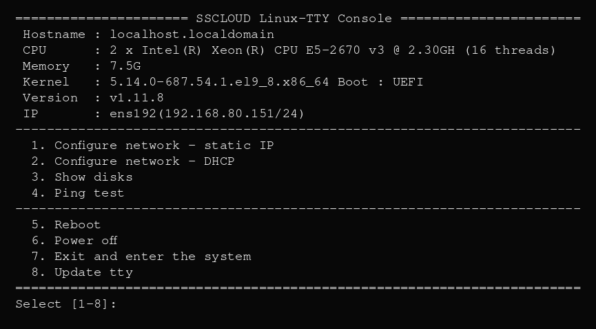

# linux-tty

**SSCLOUD Linux-TTY Console** —— 无显示器 Linux 设备的物理控制台菜单。单文件 Go 静态二进制，开机跑在物理 `tty1` 上，无需登录即可按键配置网络、Ping、查看磁盘、重启/关机。

支持 RHEL/CentOS/Rocky/Alma 与 Debian/Ubuntu。



## 菜单

| 按键 | 功能 |
|------|------|
| 1 | 静态 IP（自动备份原配置） |
| 2 | DHCP |
| 3 | 磁盘列表（整盘，系统盘标 `[SYS]`） |
| 4 | Ping 223.6.6.6 |
| 5 | 重启 |
| 6 | 关机 |
| 7 | 进入系统（agetty 账号密码登录，退出自动回菜单） |
| 8 | 在线更新（优先 curl，其次 wget；需要网络） |
| `666` | 隐藏：免密进入 root shell（菜单不显示） |

任意输入框按 `Ctrl+C` / `ESC` 回主菜单。

修改网络配置前会备份到 `/var/backups/netcfg`；如果新配置应用失败，会自动恢复并重新应用旧配置。RHEL 的 ifcfg 重写会保留 `UUID`、`HWADDR`、`MTU`、`ETHTOOL_OPTS` 等非网络地址字段。

菜单 3 同时支持 LSI MegaRAID / Dell PERC（`perccli`/`storcli`）和 **HP Smart Array**（`ssacli`/`hpssacli`/`hpacucli`）。SLOT 列会带上 RAID 模式：单盘逻辑卷显示 `RAID0:12`，多盘阵列父行显示 `RAID5`、子行显示槽位号。Dell PERC 的槽位来自 `EID:Slot`，显示时只取 Slot；HP 逻辑卷通过 `ssacli ctrl all show config detail` 映射回物理盘位。磁盘页按终端高度自动分页填满屏幕：BIOS 25 行时每页 18 行数据，UEFI 48 行时每页 41 行；按 Enter 翻页、输入 `q` 退出。表格按终端实际列数自适应：80 列时保持最小六列布局（DEVICE/SIZE/TYPE/SLOT/HEALTH/SERIAL），更宽的 UEFI 控制台会把六列按比例铺满整行，表头和宽屏内容居中；超长字段用 `...` 截断。SERIAL 列显示“品牌-序列号”（如 `INTEL-PHYS...`、`HGST-VKK...`），品牌从阵列卡/udev 的 Model 推断；NVMe 再用 PCI vendor ID 兜底（如 `0x1c5f` → MEMBLAZE、`0x1b96` → WD），识别不到时只显示序列号。没有阵列卡时，`ID_BUS=scsi` 的直连盘再用 `smartctl -i` 区分 SATA / SAS，避免把 SAS HBA 后面的 SATA 盘误标成 SAS。SR130/SAS3008 这类控制器在未配置 VD 时会把物理盘以 `UGood / DG=-` 暴露给 OS；菜单会从 `storcli64` 读取其 EID:Slot、SATA/SAS、SSD/HDD 和序列号，不再回退到系统默认值。HEALTH 由阵列卡工具计算：PERC 读取 `State`、介质/其他错误、预测故障和 SMART，HP 读取物理盘与逻辑盘 `Status`；NVMe 在安装 `smartctl` 时显示**剩余寿命百分比**（100% - `Percentage Used`），失败显示 `BAD`；直通盘用 `smartctl -H` 显示 `OK`/`BAD`。正常 `OK`、预警 `WARN`、故障 `BAD`，无健康数据源的盘显示 `-`。逻辑卷对应多块物理盘时，父行显示 RAID 模式，下面用树形列出每个物理盘位和序列号。NVMe 盘优先通过 SMBIOS 显示 PCIe 插槽名（如 `Slot 2`），没有映射时回退到 PCI 地址。

### 手动槽位映射

部分服务器的 SMBIOS 不提供 NVMe 物理槽位（DMI 中为 `0000:ff:1f.7` 占位符）。二进制已内置 Dell R730xd 的 Slot 6 拆分规则：`05:00.0` / `06:00.0` 分别显示 `Slot 6-1` / `Slot 6-2`，不再需要额外配置文件。其他机型仍可创建可选文件 `/etc/linux-tty.slots` 覆盖 SLOT 列，键可以是 PCI BDF、设备名或磁盘序列号，值取该行剩余文本：

```text
05:00.0          Slot 6-1
06:00.0          Slot 6-2
nvme0n1          Slot 6-1
S438NA0N910155   Slot 6-1
```

菜单会优先使用该映射；没有配置的盘继续走 SMBIOS/PCI 地址自动映射。修改后重启 `linux-tty@tty1` 生效。

## 快速安装

```bash
curl -fsSL https://bash.niteng.net/iso/tty.sh | bash
```

自动完成：下载二进制、安装 systemd unit、关闭 sysrq。装完即跑在 tty1。

已安装的机器可以跑同一条命令更新，也可以直接在控制台菜单按 `8` 更新。

安装脚本支持两个环境变量：

- `LINUX_TTY_TARGET=tty1`：安装/重启哪个 tty 实例（默认 `tty1`）
- `LINUX_TTY_NO_RESTART=1`：只安装二进制，不重启服务（菜单 8 使用，由菜单自己重启当前 tty）

## 手动部署

```bash
# 1. 二进制
install -m 0700 linux-tty /usr/local/sbin/linux-tty

# 2. systemd unit
cat > /etc/systemd/system/linux-tty@.service <<'EOF'
[Unit]
Description=SSCLOUD Linux-TTY Console
After=systemd-user-sessions.service plymouth-quit-wait.service
Before=getty.target
Conflicts=getty@%i.service linux-root@%i.service

[Service]
Environment=LANG=en_US.UTF-8
ExecStart=/usr/local/sbin/linux-tty
Restart=always
RestartSec=0
StandardInput=tty
StandardOutput=tty
StandardError=tty
TTYPath=/dev/%I
KillMode=process

[Install]
WantedBy=multi-user.target
EOF

# 3. 666 root-shell 脚本（不需要可删）
cat > /usr/local/sbin/linux-root-shell <<'EOF'
#!/bin/bash
/bin/bash -l
exec /usr/local/sbin/linux-tty
EOF
chmod 700 /usr/local/sbin/linux-root-shell

# 4. 关闭 sysrq
echo 'kernel.sysrq = 0' > /etc/sysctl.d/99-linux-tty.conf
sysctl -w kernel.sysrq=0

# 5. 启用
systemctl daemon-reload
systemctl enable --now linux-tty@tty1.service
```

## 网络后端

启动时读 `/etc/os-release` 自动探测发行版：

- **RHEL 系**（CentOS/RHEL/Rocky/Alma/Fedora）：写 `/etc/sysconfig/network-scripts/ifcfg-*`，`nmcli` 生效。
- **Debian 系**（Debian/Ubuntu/Kali）：netplan 或 `/etc/network/interfaces`，自动识别；netplan 会保留原有的 `renderer`（networkd/NetworkManager）。

bond/bridge/VLAN/team/OVS 主接口或其成员接口会被拒绝修改，避免破坏堆叠网络配置。bond 主接口（`/sys/class/net/<nic>/bonding`）的 IP 会显示在菜单顶部。

## 编译

```bash
# Windows（自动递增 patch 版本并写 VERSION）
.\build.ps1

# Linux/macOS（手动指定版本号）
CGO_ENABLED=0 GOOS=linux GOARCH=amd64 go build -ldflags="-s -w -X main.version=vX.Y.Z" -o linux-tty .
```

静态链接、无第三方 Go 依赖，x86_64，约 2.5 MB。运行时仍会调用系统自带的 `ip`、`nmcli`/`ifupdown`/`netplan`、`udevadm`、`lscpu`、`ping`、`agetty` 等命令；最小化系统如果缺少这些工具，对应功能会降级或报错。

版本号只在 `build.ps1` 中自动递增；Linux 构建命令需要手动传入。

单元测试：

```bash
cd src && go test ./...
```

## 安全

- 二进制 `0700 root:root`，必须 root 运行。
- `666` 是隐藏免密 root 入口，物理控制台任何人输入即得 root，**仅在物理访问受控的设备上启用**；不需要时删掉 `/usr/local/sbin/linux-root-shell` 即可关闭。
- 菜单 8 会以 root 执行从 `bash.niteng.net` 下载的安装脚本；无法访问该地址的环境请改用 U 盘/离线安装。
- 安装脚本会保留上一版二进制为 `/usr/local/sbin/linux-tty.bak`，新版本启动失败时可用于回滚。

## 卸载

```bash
systemctl disable --now linux-tty@tty1.service
rm -f /etc/systemd/system/linux-tty@.service
rm -f /usr/local/sbin/linux-root-shell
rm -f /usr/local/sbin/linux-tty /usr/local/sbin/linux-tty.bak
rm -f /etc/sysctl.d/99-linux-tty.conf
rm -f /etc/netplan/99-linux-tty.yaml
systemctl daemon-reload
```

网络配置文件不会自动还原，需要时从 `/var/backups/netcfg` 手动恢复。
